# 16-bit CPU in Logisim Evolution

A custom **16-bit CPU** built in **Logisim Evolution**, centered on the final integrated circuit **`BOSS_VIVA_JUMP_3`** and supported by a large library of custom subcircuits including adders, multiplexers, decoders, comparators, multipliers, a bus terminal, matrix-multiplication helpers, and ALU-related logic.

> **Final integrated CPU for this repository:** `BOSS_VIVA_JUMP_3`
>
> **Project status:** Final circuit used in the viva: `BOSS_VIVA_JUMP_3`. The author reports successful practice and TA-viva test runs. The advanced boss-viva challenge required manual debugging and was run partially. These historical results have not been independently rerun during repository preparation.

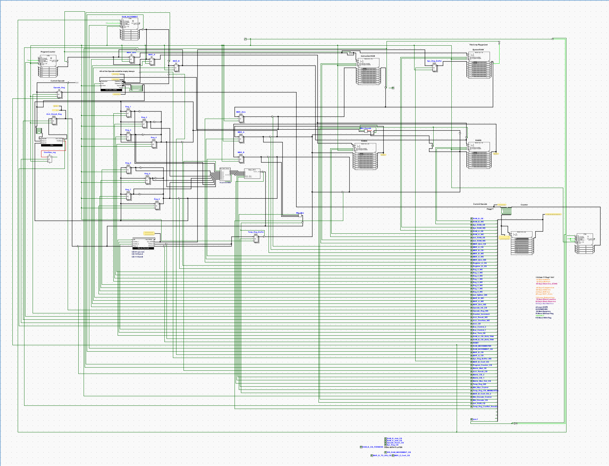

## Overview

This project was created for a Fall 2024 *Introduction to Computational Thinking* 16-bit CPU assignment. The supplied Logisim circuit file contains **56 named circuits**, ranging from basic arithmetic and logic building blocks to multiple full-CPU revisions. The final version used for the viva and documented here is **`BOSS_VIVA_JUMP_3`**.

This repository preserves the original Logisim project, supporting designs, visual documentation, memory initialization files, and the controller ROM image. It is designed to do two things:

1. preserve the **final CPU implementation**, and
2. showcase the **mini systems / subcircuits** that were built along the way.

That second part is important because the project is not just one top-level circuit. It also includes a substantial amount of reusable lower-level hardware design work.

## Final CPU focus

The main circuit to inspect for the final design is:

- **`BOSS_VIVA_JUMP_3`**

Earlier circuits such as `Prize_Circuit_*`, `BOSS_VIVA_JUMP_2`, and other variants are preserved as part of the development history, but they should be treated as intermediate or experimental stages unless explicitly stated otherwise.

## Architecture at a glance

| Subsystem | Observed in supplied project / specification |
| --- | --- |
| CPU width | 16-bit datapath |
| Final top-level circuit | `BOSS_VIVA_JUMP_3` |
| Memory | 4 RAM blocks, 16-bit words, 5-bit addresses (per supplied project docs) |
| Address registers | 3 MAR registers |
| Buffer registers | 3 MBR registers |
| Register bank | 8 general CPU input registers, each 16-bit |
| Output register | 1 CPU output register, 16-bit |
| ALU | Custom ALU-related circuitry, with project specs targeting 12–16 operations |
| Control | ROM-based PCU / controller with counters |
| Interconnect | 3 separate 16-bit buses and a bus terminal |

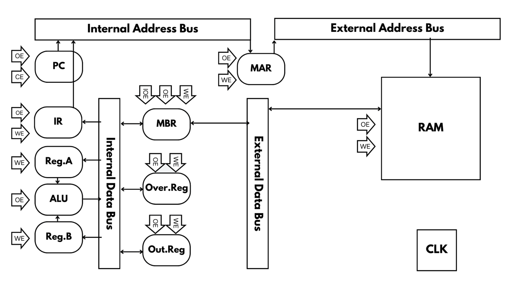

## Repository contents

```text
16-bit-cpu-logisim-repository/
├── README.md
├── src/
│   ├── 16_Bit.circ                 # Original Logisim project, 56 subcircuits
│   └── rom/ROM_CONTENTS.hex       # Control ROM initialization image
├── assets/
│   ├── images/final-cpu/          # Full CPU + datapath close-up
│   ├── images/control/            # ROM controller and signals
│   ├── images/subcircuits/        # ALU, MUX, decoder, arithmetic, etc.
│   └── images/architecture/       # Course architecture reference
├── docs/
│   ├── architecture.md
│   ├── circuit-index.md
│   ├── instruction-set.md
│   ├── subcircuits.md
│   └── testing.md
├── tests/memory-images/          # Instruction RAM / data RAM scripts
└── CONTRIBUTING.md
```

## Open and explore

1. Install [Logisim Evolution](https://github.com/logisim-evolution/logisim-evolution/releases).
2. Open `src/16_Bit.circ`.
3. In the circuit explorer/sidebar, select **`BOSS_VIVA_JUMP_3`**.
4. Use the simulator controls to inspect the datapath, memory, and ROM-based control flow.
5. Browse the supporting circuits listed in [docs/circuit-index.md](docs/circuit-index.md).

**Compatibility:** This circuit was originally made using Logisim Evolution 3.9.0. You can inspect it in a newer version, but verify simulation behavior and memory initialization after upgrading.

## Program execution and control ROM

This CPU uses **two different kinds of memory content**:

- **Instruction RAM program images:** the supplied `Practice_Script_Inst_RAM`, `TA_Viva_Inst_RAM`, and `Boss_Viva_Script.txt` files contain instruction words for their corresponding exercises. The boss-viva file is preserved as supplied; the author reports having debugged that challenge manually before running it.
- **Control ROM image:** `src/rom/ROM_CONTENTS.hex` is a separate Logisim memory image containing 64-bit control words for the ROM-based program control unit. It is **not an instruction-RAM test program**. The file uses Logisim `v3.0 hex words addressed` format, with 512 addressed words in the file.

**Use the correct image for each memory component.** The CPU cannot be reproduced reliably by loading every image into the same RAM. For practice and TA tests, also load the matching RAM A and RAM B initialization images. See [testing instructions](docs/testing.md).

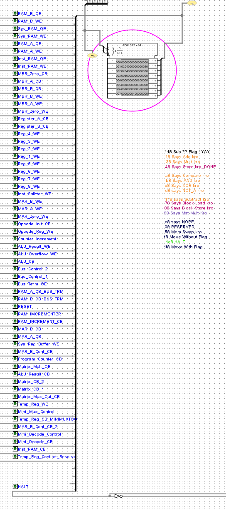

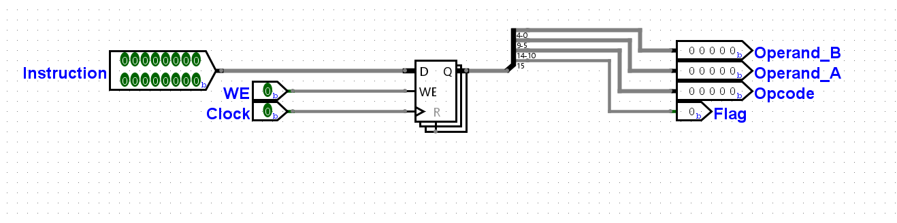

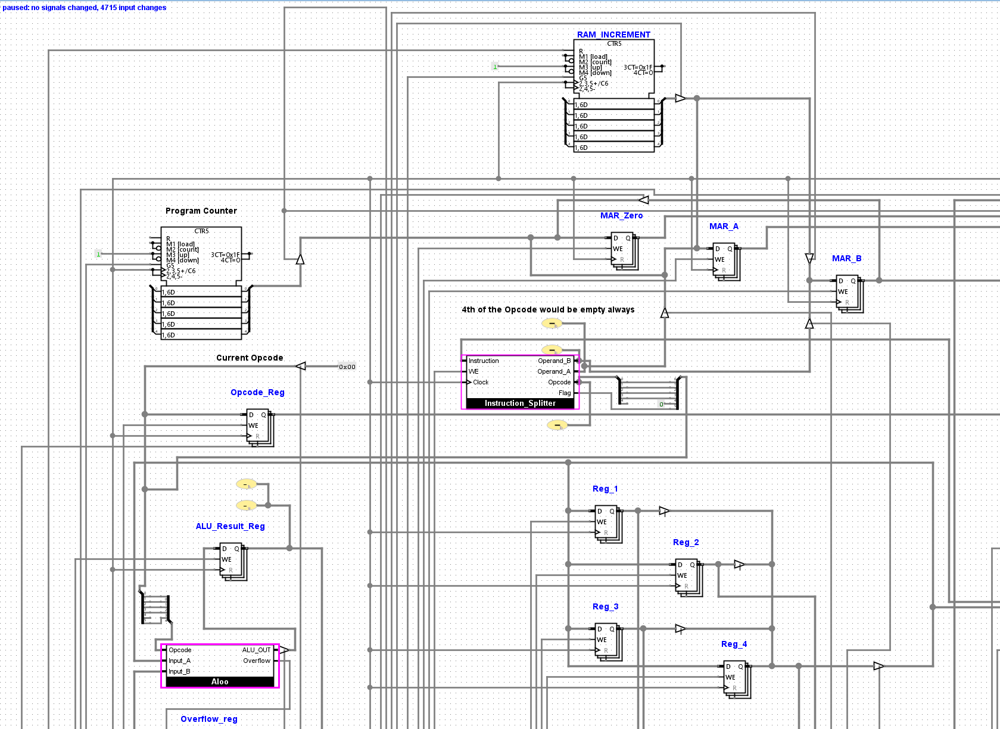

### Instruction word layout

The screenshot of the `Instruction_Splitter` identifies the following fields:

| Bit positions | Field | Width |
|---|---|---:|
| 15 | Flag | 1 bit |
| 14–10 | Opcode | 5 bits |
| 9–5 | Operand A | 5 bits |
| 4–0 | Operand B | 5 bits |

The screenshot displays a separate 5-bit opcode and flag. Instruction decoding and specific opcode behavior should be checked against the final control implementation and test images before publishing an authoritative opcode table.

## Subcircuit gallery

One of the goals of this repository is to preserve screenshots of the **mini systems** that make up the project. These should be added under `assets/images/subcircuits/` and documented in [docs/subcircuits.md](docs/subcircuits.md).

### Recommended screenshot categories

| Category | Example circuits from the project |
| --- | --- |
| Adders / arithmetic building blocks | `Add_2`, `Add_4`, `Add_8`, `Add_16`, `Sub_16`, `AddSub_8`, `AddSub_8_2` |
| Multiplexers | `Multiplexer_4x1`, `Multiplexer_8x1`, `MUX_16`, `Mux_32_2`, `Mux_32_FINAL`, `Matrix_MUX`, `Mem_Swap_MUX` |
| Decoders | `Decoder_3x8`, `Decoder_5x32`, `Decode_5x32_16bit`, `Mini_Decoder` |
| Comparators | `Comparator_1bit`, `Comparator_2bit`, `Comparator_4bit`, `Comparator_8bit`, `Comparator_16bit_Final` |
| Multipliers | `Multiplier_8`, `Multiplier_16` |
| ALU | `Aloo` |
| Bus terminal / routing | `Bus_ka_Terminal` |
| Matrix-multiplication support | `Mat_Mult_Demo`, `Mat_Mult_Demo_2`, `Matrix_MUX` |
| Instruction formatting / helpers | `Instruction_Splitter`, `Bin_Hex_Convert_BOSSVIVA` |

Each screenshot should ideally show:

- the circuit name,
- its input/output signals,
- a short caption saying what it does,
- and, if useful, one example test case.

## Circuit screenshot gallery

These screenshots come from the supplied Logisim project and show both the integrated design and the gate-level building blocks. Visual documentation is separate from execution test evidence.

### Final integrated CPU — `BOSS_VIVA_JUMP_3`


The final circuit brings together the CPU registers, memory interfaces, ALU-related path, instruction/control circuitry, and numerous control signals. See [Architecture](docs/architecture.md) for an explanation of the supplied design requirements and their relation to the schematic.

### ALU — `Aloo`

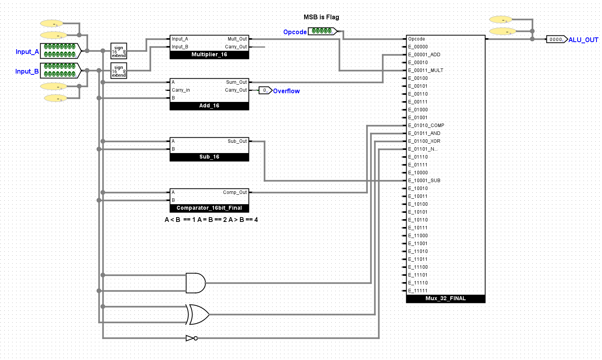

The ALU diagram shows 16-bit arithmetic blocks (`Add_16`, `Sub_16`, `Multiplier_16`, `Comparator_16bit_Final`), gates for bitwise logic, and an opcode-selected `Mux_32_FINAL` output path. The comparator legend labels A < B as 1, A = B as 2 and A > B as 4.

### Bus terminal — `Bus_ka_Terminal`

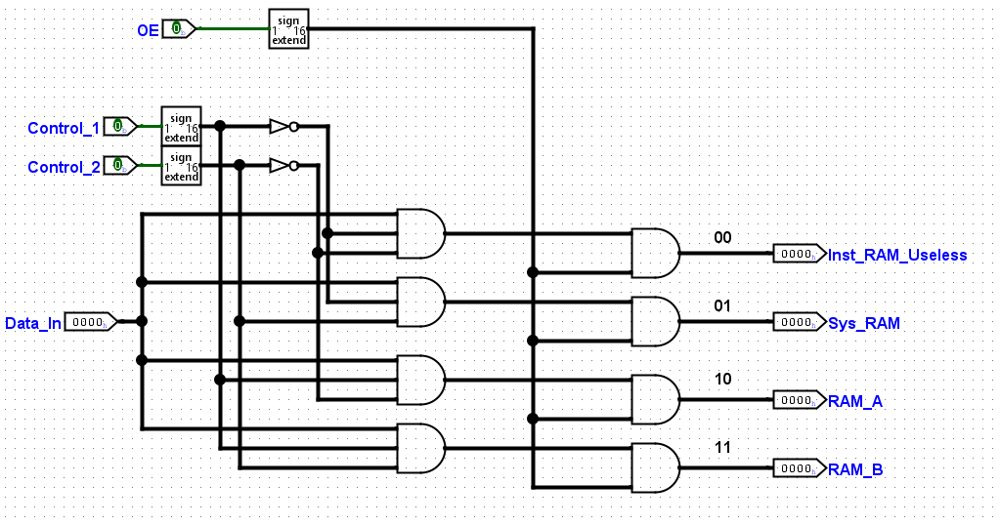

A control-line-driven routing circuit with `OE`, `Control_1`, and `Control_2` and paths labeled instruction RAM, system RAM, RAM A, and RAM B. The visible instruction-RAM path is labeled *Useless* in this particular screenshot; that label is preserved rather than interpreted as an implemented feature.

### Decoder

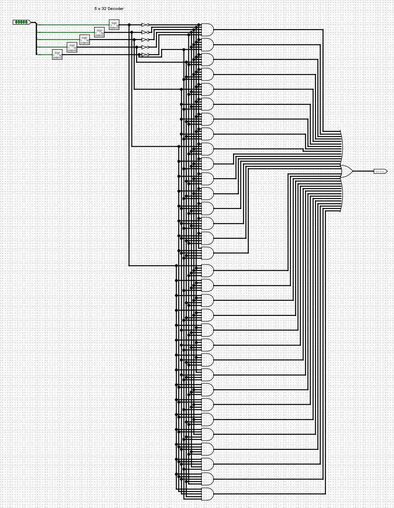

A gate-level decoder using input-bit inversions and AND gates to derive outputs for the 32 possible combinations of a 5-bit input.

### Multiplexer

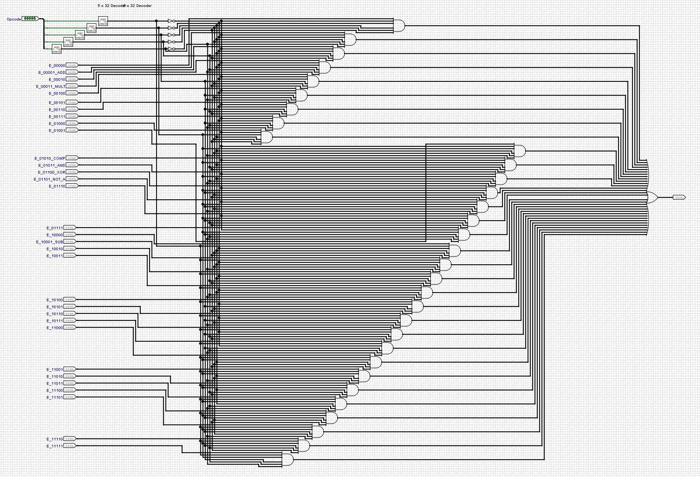

A gate-level output-selection circuit, with a 5-bit opcode and multiple input candidates combined toward a selected output. The implementation illustrates how opcode-controlled routing can be assembled from lower-level logic.

### Hierarchical 16-bit multiplier — `Multiplier_16`

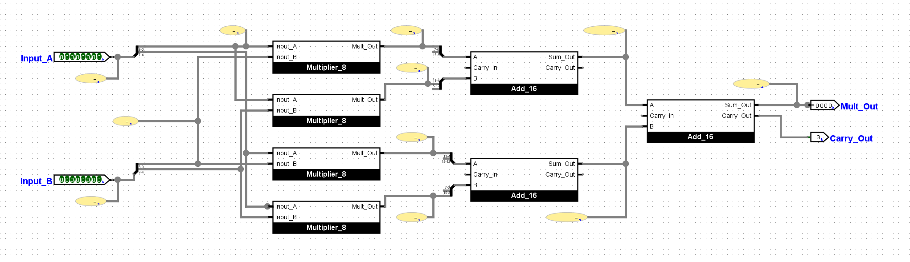

A larger multiplication block assembled from four `Multiplier_8` units and `Add_16` blocks, demonstrating hierarchical arithmetic-circuit construction.

### 2×2 matrix multiplication

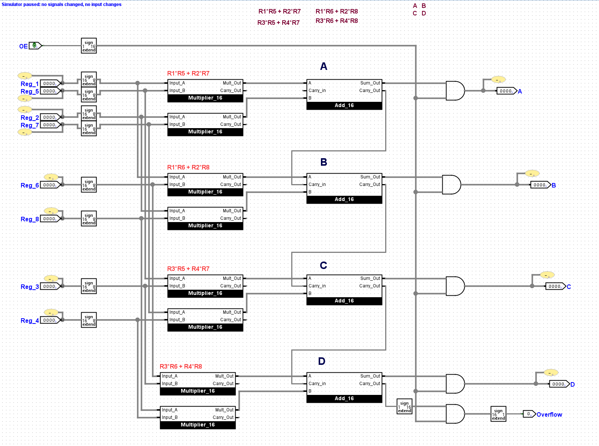

The matrix-multiplication schematic shows eight `Multiplier_16` blocks and four `Add_16` blocks producing results labeled `A`, `B`, `C`, and `D`, along with an overflow output.

### 16-bit comparator — `Comparator_16bit_Final`

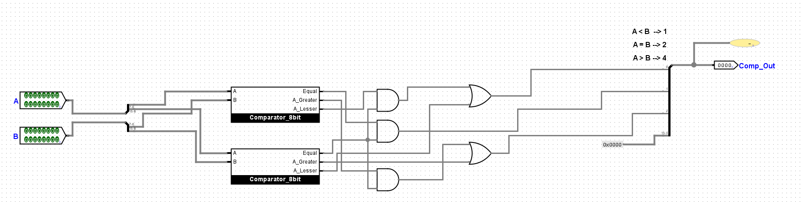

This combines two 8-bit comparator stages. The outputs encode `A < B` as 1, `A = B` as 2, and `A > B` as 4.

### Instruction splitting, program control, and datapath


For an expanded gallery and source circuit names, see [Subcircuits](docs/subcircuits.md).

## Selected custom subcircuits found in the `.circ` file

The source file contains **56 circuits**. Highlights include:

- **Arithmetic:** `Add_2`, `Add_4`, `Add_8`, `Add_16`, `Sub_16`, `AddSub_8`, `AddSub_8_2`
- **Multiplication:** `Multiplier_8`, `Multiplier_16`
- **Comparison:** `Comparator_1bit`, `Comparator_2bit`, `Comparator_4bit`, `Comparator_8bit`, `Comparator_16bit_Final`
- **Decoding / multiplexing:** `Decoder_3x8`, `Decoder_5x32`, `Decode_5x32_16bit`, `Multiplexer_4x1`, `Multiplexer_8x1`, `MUX_16`, `Mux_32_2`, `Mux_32_FINAL`, `Matrix_MUX`, `Mem_Swap_MUX`
- **ALU and CPU helpers:** `Aloo`, `Instruction_Splitter`, `Bus_ka_Terminal`, `Bin_Hex_Convert_BOSSVIVA`
- **Integrated CPU revisions:** `main`, `Prize_Circuit_*`, `BOSS_VIVA_JUMP_*`, `Temp_Zohaib`

See the full list in [docs/circuit-index.md](docs/circuit-index.md).

## Instruction set and functionality

The assignment documents specify a broader required behavior including:

- ROM-based control execution,
- at least 12 implemented instructions,
- mandatory `MAT MULT`, `Block Load`, and `Block Store`,
- execution of provided test scripts,
- architectural flow using MAR / MBR / RAM buses.

These requirements come from the supplied course material and should not be presented as automatically verified behavior unless tested on `BOSS_VIVA_JUMP_3`.

See [docs/instruction-set.md](docs/instruction-set.md) and [docs/testing.md](docs/testing.md).

## Testing and validation

The author reports that the **practice and TA-viva scripts executed successfully** on the project. The **boss-viva script was an intentionally challenging debugging exercise**: after manual correction, it executed partially. These are reported historical results, **not fresh simulation runs** performed for this repository.

The scripts are machine-code memory images, not prose-only instructions: load each `*_Inst_RAM` file into **Instruction RAM**, and the corresponding `*_RAM_A` / `*_RAM_B` files into their respective data memories. The boss-viva script is also an Instruction RAM program, but the supplied file may require debugging and should not be described as a verified end-to-end test. The independent **control ROM** image belongs in the controller's ROM, *not* Instruction RAM.

See [docs/testing.md](docs/testing.md) for file-by-file mapping, a safe reproduction workflow and validation status.

## Development history

The project includes many iterations such as `Prize_Circuit_8_MemSwap`, `Prize_Circuit_10_Final_BOSS`, `BOSS_VIVA_JUMP_2`, and finally `BOSS_VIVA_JUMP_3`. This makes the repository useful not only as a final submission archive, but also as a design-history record.

## References

This repository was documented using the project materials supplied with the circuit, including:

- *Building a 16 bit CPU*, Introduction to Computational Thinking, IBA Karachi, Fall 2024.
- *Architecture: Final Pre-Release*.
- *ITC Boss level* addendum.
- *MAT MULT 2×2*.
- *Matrix Multiplication*.
- Albert P. Malvino and Jerald A. Brown, *Digital Computer Electronics*, 3rd ed.
- Sarah L. Harris and David Money Harris, *Digital Design and Computer Architecture: RISC-V Edition*.
- [Logisim Evolution](https://github.com/logisim-evolution/logisim-evolution).

The PDFs themselves are not redistributed as public repository content.

## Attribution and publishing

The project was developed for an Introduction to Computational Thinking assignment at IBA Karachi (Fall 2024), using the course architecture and specification documents as requirements. The books and lecture resources listed above are cited for context, not redistributed. Specific collaborators and individual contributions should be acknowledged where appropriate.

No open-source license is included until the authors decide which permissions to grant. This project should not be described as an implementation of the RISC-V ISA just because a RISC-V architecture book was consulted.
