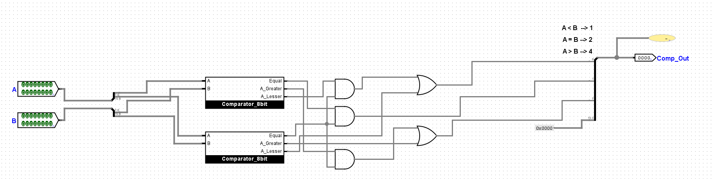
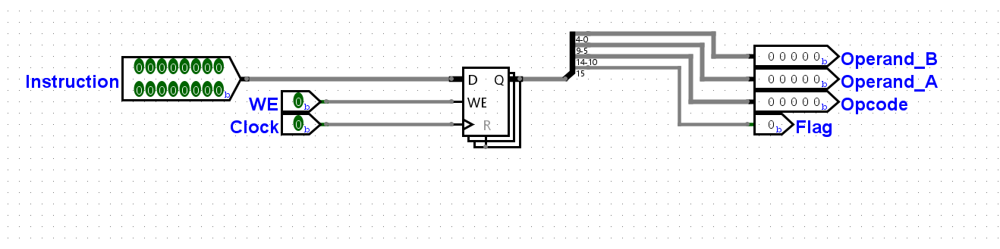
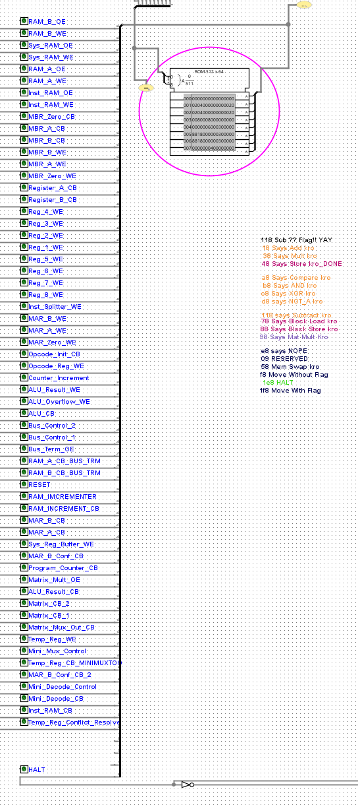
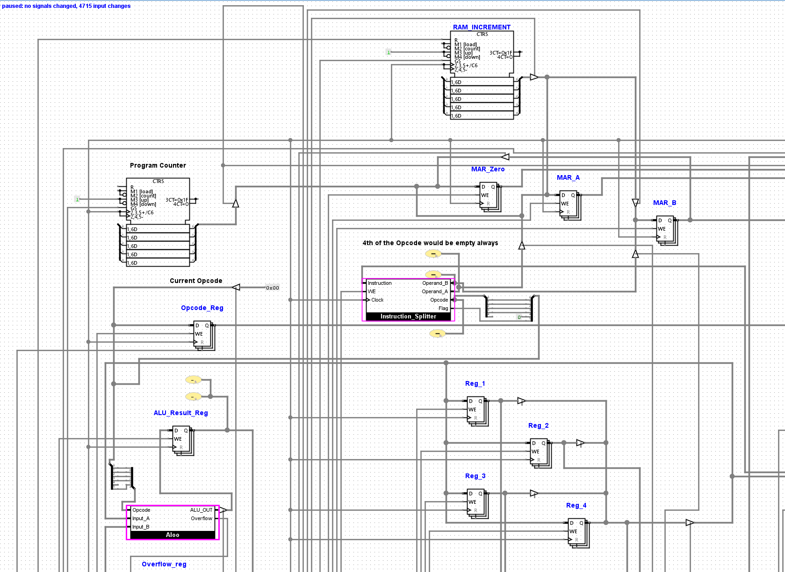

# Subcircuits and mini systems

This document is meant to showcase the **building blocks** behind the final CPU. The final top-level circuit is `BOSS_VIVA_JUMP_3`, but a major part of the project is the set of custom-designed reusable components that support it.

## Screenshots already included

| System | Screenshot |
| --- | --- |
| Final CPU | [View](../assets/images/final-cpu/boss-viva-jump-3-overview.png) |
| ALU | [View](../assets/images/subcircuits/alu/alu-overview.png) |
| Bus terminal | [View](../assets/images/subcircuits/bus-terminal/bus-terminal.png) |
| 5×32 decoder | [View](../assets/images/subcircuits/decoders/decoder-5x32.png) |
| Multiplexer | [View](../assets/images/subcircuits/multiplexers/mux-gate-level.png) |
| 16-bit multiplier | [View](../assets/images/subcircuits/multipliers/multiplier-16.png) |
| Matrix multiplication | [View](../assets/images/subcircuits/matrix/matrix-multiplication.png) |

## Why this section matters

A GitHub repository for this project should not only show the final CPU screenshot. It should also preserve the smaller systems that demonstrate the actual design work, such as custom multiplexers, decoders, bus-routing logic, ALU-related circuitry, multipliers, and matrix helpers.

## Recommended screenshot folder structure

Store screenshots in these folders:

```text
assets/images/subcircuits/
├── adders/
├── multiplexers/
├── decoders/
├── comparators/
├── multipliers/
├── alu/
├── bus-terminal/
└── matrix/
```

## Suggested screenshots to capture

### 1. Adders and arithmetic primitives
- `Add_2`
- `Add_4`
- `Add_8`
- `Add_16`
- `Sub_16`
- `AddSub_8`
- `AddSub_8_2`

### 2. Multiplexers and routing helpers
- `Multiplexer_4x1`
- `Multiplexer_8x1`
- `MUX_16`
- `Mux_32_2`
- `Mux_32_FINAL`
- `Matrix_MUX`
- `Mem_Swap_MUX`

### 3. Decoders
- `Decoder_3x8`
- `Decoder_5x32`
- `Decode_5x32_16bit`
- `Mini_Decoder`

### 4. Comparators
- `Comparator_1bit`
- `Comparator_2bit`
- `Comparator_4bit`
- `Comparator_8bit`
- `Comparator_16bit_Final`

### 5. Multipliers
- `Multiplier_8`
- `Multiplier_16`

### 6. ALU and CPU helper blocks
- `Aloo`
- `Instruction_Splitter`
- `Bin_Hex_Convert_BOSSVIVA`

### 7. Bus-routing system
- `Bus_ka_Terminal`

### 8. Matrix-multiplication helper circuits
- `Mat_Mult_Demo`
- `Mat_Mult_Demo_2`
- `Matrix_MUX`

## Suggested naming convention for image files

Use lowercase names with hyphens, for example:

- `assets/images/subcircuits/alu/aloo-overview.png`
- `assets/images/subcircuits/multiplexers/mux-32-final.png`
- `assets/images/subcircuits/decoders/decoder-5x32.png`
- `assets/images/subcircuits/bus-terminal/bus-ka-terminal.png`

## Recommended caption format

For each image, document:

- **Circuit name**
- **Purpose**
- **Inputs / outputs**
- **How it contributes to the final CPU**

Example:

### `Aloo`
Custom ALU-related subcircuit used as the arithmetic and logic engine of the CPU. It integrates lower-level arithmetic components and contributes to instruction execution in the final `BOSS_VIVA_JUMP_3` design.

```md

```

## Suggested GitHub presentation pattern

Inside the main README, you can add a section such as:

- **Final CPU**
- **Architecture diagram**
- **Mini systems gallery**
- **Instruction set**
- **Testing and validation**

That way, visitors first understand the overall system, then see the building blocks.

## Important note

Not every subcircuit needs a long explanation. Some can simply be grouped by category with one or two sentences each. The most important ones to emphasize are:

- `BOSS_VIVA_JUMP_3`
- `Aloo`
- `Bus_ka_Terminal`
- `Mux_32_FINAL`
- `Decoder_5x32` / `Decode_5x32_16bit`
- `Multiplier_16`
- `Mat_Mult_Demo` / matrix support circuits


## Newly supplied circuit screenshots

### Comparator


### Instruction splitter


### Control ROM and control lines


### Final CPU datapath close-up

